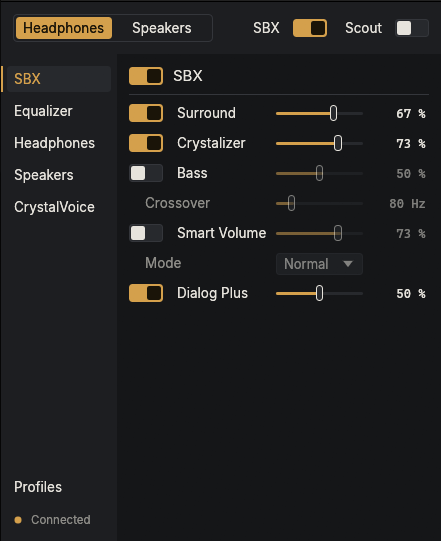
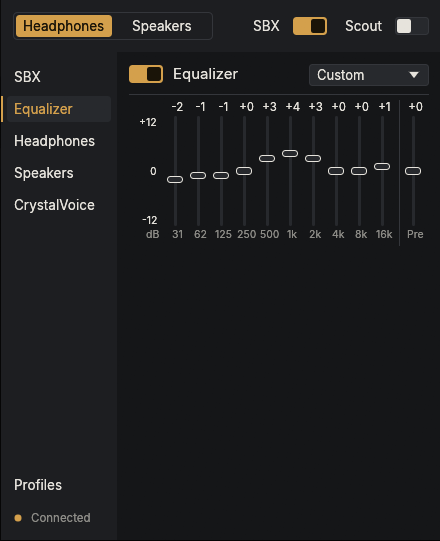
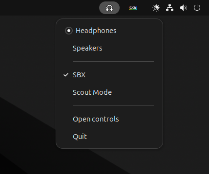

# Sound Blaster X7 on Linux

> **How this was made.** The code was written with Claude (Opus 5.5 and
> Fable 5.1) with a person at the keyboard directing, testing and
> reviewing. The protocol was not guessed: every command came from a USB
> capture of Creative's Windows control panel, was replayed against a
> real X7 on Linux, and its effect was checked by that person on the
> device, by ear or on the value read back. This is an independent
> project with no involvement from Creative; Sound Blaster is their
> trademark.

The Creative Sound Blaster X7 is a USB DAC and headphone amplifier with
speaker outputs. Its audio works on Linux out of the box, but every
setting the Windows control panel offers is reached over a USB HID
control interface that Linux has nothing for. This is that control
software: a command-line tool and a tray app that switch the output
between headphones and speakers and set SBX Pro Studio, the equalizer,
headphone and amplifier options, speaker layout and bass management,
CrystalVoice, Scout Mode and profiles. It talks HID only; it never
touches the audio path.

Two binaries, one library:

- `x7`: the command-line tool.
- `x7-gui`: a tray icon plus a control window.

<p align="center">
  
  
</p>

## Install

One command fetches the latest release and installs it for your user:

```sh
curl -fsSL https://raw.githubusercontent.com/Stamrin/x7/main/install.sh | sh
```

Or download `x7-<version>-x86_64-linux.tar.gz` from the Releases page,
unpack it, and run `./install.sh` inside.

The installer puts `x7` and `x7-gui` in `~/.local/bin`, adds a launcher
entry and an autostart entry (`--no-autostart` skips the latter), and
asks before running the two `sudo` lines that install the udev rule, the
one root step; without the rule the device node is root-only. Unplug and
replug the X7 afterwards. The tray icon comes up at the end of the
install. Run the same command again to update, then Quit the tray and
start it again.
`install.sh --uninstall` removes everything it installed and leaves your
profiles in `~/.config/x7/`.

Needs x86_64 Linux with glibc 2.35 or newer: Ubuntu 22.04, Fedora 36,
current Arch and Bazzite, or anything newer. `~/.local/bin` is on the
PATH by default on Ubuntu, Fedora and Omarchy. No other packages: the
window embeds its fonts, and the GL, X11 and Wayland libraries it opens
at runtime are on every desktop.

### GNOME and KDE

GNOME needs the AppIndicator extension (`ubuntu-appindicators@ubuntu.com`
on Ubuntu, "AppIndicator and KStatusNotifierItem Support" elsewhere) for
the tray icon. The app copes with the extension loading after it does:
without a tray host the window opens and closing it quits; once a host
appears, closing puts the app back in the tray.

### Hyprland (Omarchy)

Only one `x7-gui` runs per session: it holds the name
`io.github.stamrin.x7gui` on the session bus, and a second launch asks the
running one to show its window, then exits. Use whichever launch path your
session has:

- Session started through UWSM (Omarchy does this): the autostart entry
  the installer adds is enough. UWSM runs XDG autostart entries through systemd.
- Plain Hyprland without UWSM: no XDG autostart, so add to `hyprland.conf`:

  ```
  exec-once = x7-gui
  ```

The controls window is 440 px wide and is meant to float. Hyprland's rule
syntax has changed several times; check `hyprctl version` and use the form
its wiki shows for that release. The window's class is `x7-gui`.

- Hyprland 0.47 and earlier:

  ```
  windowrulev2 = float, class:^(x7-gui)$
  windowrulev2 = center, class:^(x7-gui)$
  ```

- Later `hyprland.conf` releases, unified `windowrule` with the same
  fields, and then the last conf releases before Lua, which take
  `match:` props and `on` effects:

  ```
  windowrule = float, class:^(x7-gui)$
  windowrule = center, class:^(x7-gui)$
  ```

  ```
  windowrule = float on, center on, match:class ^(x7-gui)$
  ```

- Hyprland 0.55 and later, Lua configuration:

  ```lua
  hl.window_rule({
      match = { class = "^(x7-gui)$" },
      float = true,
      center = true,
  })
  ```

Daily use on Omarchy: the app starts in the tray and stays there. Switch
between headphones and speakers from the tray menu. A left click on the
icon, or its "Open controls" entry, opens the window; Super+W closes it
back to the tray (there is no close button under Hyprland, and a line at
the foot of the window says so); Quit in the tray menu exits. To open the
window from the keyboard, bind a free key to `x7-gui` in
`~/.config/hypr/bindings.lua`; a second launch tells the running app to
open its window:

```lua
o.bind("SUPER + ALT + X", "Sound Blaster X7", "x7-gui")
```

Super+Alt+S works too, as for any window: it parks the window in
Hyprland's scratchpad and Super+S brings it back.

The Omarchy shell's `omarchy.tray` widget shows the icon. The window takes
its colours from the active Omarchy theme, read from
`~/.local/state/omarchy/current/theme/colors.toml`, and follows
`omarchy theme set` within a second; its `mode` line decides light or dark
there, not the desktop preference. The file is read only inside an Omarchy
session (`OMARCHY_PATH` set), so a home shared with another desktop keeps
the built-in colours there.

### Bazzite and other immutable Fedora

The installer works as is: the binaries go to your home directory, and
`/etc` is writable for the rule.

## Using it

The tray icon shows the active output. Its menu switches between
Headphones and Speakers, toggles SBX and Scout Mode, opens the controls
window, and quits.

<p align="center">
  
</p>

The window has six pages:

- SBX: the SBX Pro Studio master switch and its effects (Surround,
  Dialog Plus, Smart Volume, Crystalizer, Bass with its crossover), plus
  Scout Mode.
- Equalizer: on or off, the ten bands, the preamp, and the presets.
- Headphones: gain, Direct Mode, Direct Mode for SPDIF-In, High Power
  Amplification.
- Speakers: layout, full-range flags, bass redirection and crossover,
  subwoofer gain, output target, auto standby.
- CrystalVoice: the master switch, echo cancellation, noise reduction,
  Focus with its angle, and the mic Smart Volume.
- Profiles: save the current settings under a name and load one back.

The CLI covers the same settings. Every group lists its current values
when called bare, and sets one when given a name and a value:

```sh
x7 output                      # headphones or speakers
x7 output speakers
x7 sbx                         # list; `x7 sbx on|off` for the master switch
x7 sbx crystalizer-level 0.5
x7 eq preset rock
x7 eq 125hz -2
x7 headphones gain high
x7 speakers layout 2.0
x7 voice noise-reduction on
x7 scout on
x7 profile save evening        # ~/.config/x7/profiles/evening.toml
x7 profile load evening
```

Profiles are TOML files in `~/.config/x7/profiles/`; a profile name with
a `/` or a `.` in it is taken as a path instead.

Mixer settings such as mic monitoring are not reachable from userspace;
see "UAC (mixer) from userspace" in [`docs/protocol.md`](docs/protocol.md).
Master volume and mute already work through ALSA and the kernel's HID
consumer-control mapping, so the knob and its button need nothing from
this software.

## Build from source

Rust toolchain through [rustup](https://rustup.rs) (edition 2024), then:

```sh
cargo build --release -p x7 -p x7-gui
install -Dm755 target/release/x7 target/release/x7-gui -t ~/.local/bin
sudo install -m 644 70-soundblaster-x7.rules /etc/udev/rules.d/
sudo udevadm control --reload
```

Then unplug and replug the X7. The rule file sorts before
`73-seat-late.rules`, which is what makes `TAG+="uaccess"` take effect;
check with `getfacl /dev/hidrawN` that your user is listed.

On Bazzite, build inside a distrobox so the host stays clean; the home
directory is shared, so the binaries land in `~/.local/bin` on the host:

```sh
distrobox create --name rust --image fedora:latest
distrobox enter rust -- sudo dnf install -y gcc
distrobox enter rust -- sh -c 'curl https://sh.rustup.rs -sSf | sh -s -- -y --profile minimal'
distrobox enter rust -- ~/.cargo/bin/cargo build --release -p x7 -p x7-gui
```

## Development

The three gates, which CI runs on every push together with shellcheck
and the installer harness:

```sh
cargo test --workspace
cargo clippy --workspace --all-targets -- -D warnings
cargo fmt --all --check
```

Work on the window without the X7:

```sh
cargo run -p x7-gui -- --fake          # an in-memory X7, every control live
cargo run -p x7-gui -- --fake=absent   # no device, the not-connected state
```

The fake answers with the device's own reports and keeps the values it
is given; nothing touches hidraw.

The window embeds two fonts so it looks the same on every desktop: Inter
Regular and Cascadia Mono Regular, both under the SIL Open Font License,
in `x7-gui/fonts/` with their licence files. The tray icons are drawn by
`x7-gui/icons/make-icons.py` (Pillow) and committed as raw ARGB, so
neither Pillow nor a font package is needed to build.

`dist/package.sh <version>` builds the release tarball the way CI does;
run it inside `ubuntu:22.04` to get the same glibc floor.
`sh dist/install-test.sh .` exercises `install.sh` without root, a
device, or GitHub.

Releasing: bump both crate versions together and tag `v<version>`; the
release workflow builds the tarball and creates the GitHub Release.

## Protocol

The device speaks a small command set over 64-byte HID output reports,
captured from the Windows control panel and verified on hidraw. Every
command, reply and device event this software uses, and the ones it does
not use yet, are in [`docs/protocol.md`](docs/protocol.md).

## Contributing

Never send USB Audio Class requests or detach the kernel audio driver;
the reason is in `docs/protocol.md` under UAC (mixer) from userspace.

## Licence and credits

MIT, see `LICENSE`. The protocol groundwork came from
[Sayrus/x7-bluetooth-control](https://github.com/Sayrus/x7-bluetooth-control).
Inter and Cascadia Mono are used under the SIL Open Font License.
